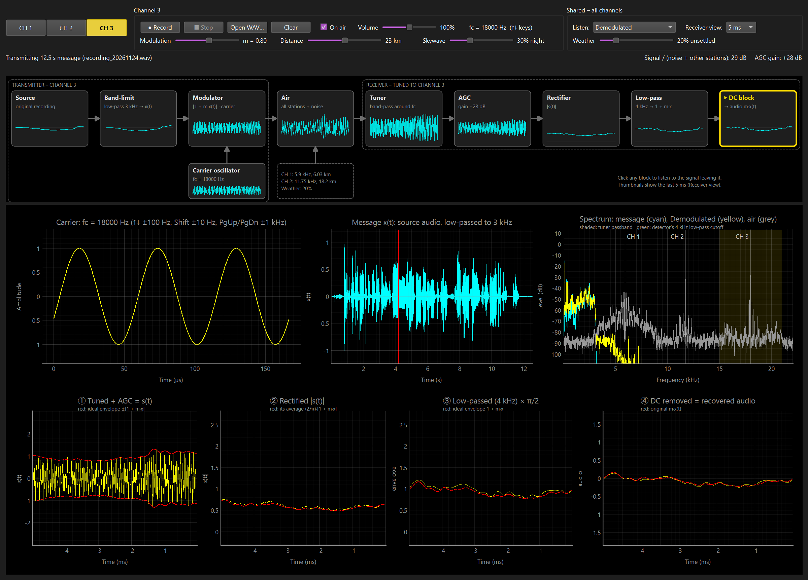

# AMSim

An interactive AM (amplitude modulation) radio simulator. Put up to three stations on the air, tune a
receiver to one of them, and see and hear the signal at every step from the
original recording to the recovered audio.



*AMSim as it starts, with the three sample recordings on the air on channel 1
(5.9 kHz), channel 2 (11.75 kHz) and channel 3 (18 kHz). The receiver is tuned to
channel 3 and is playing the demodulated audio. All three stations are visible in the
spectrum at the upper right; the shaded band is what the tuner lets through.*

## Getting started

You need Python 3 and an audio output device. A microphone is only needed for
recording.

```
pip install numpy scipy sounddevice pyqtgraph PyQt6
python main.py
```

The three sample recordings in this repository load on channels 1, 2 and 3.
To use your own messages instead, give up to three WAV files. They go to channels 1,
2 and 3 in order:

```
python main.py first.wav second.wav third.wav
```

The app starts on **Demodulated**, which plays what the receiver recovers, tuned to
channel 3 (channel 1 if you give your own files). Click the **Source** block (or
choose **Original recording** under **Listen**) to hear the source audio directly.

The stations start at different distances, with some skywave fading and 20 % weather.
To change the launch settings, edit `START_CHANNELS` and the other `START_` values in
`main.py`.

## How it works

| Part | What happens |
|---|---|
| **Transmitter** | The message is low-passed to 3 kHz, scaled to a peak of 1, and used to modulate a sine carrier: `s(t) = [1 + m·x(t)] · sin(2π·fc·t)` |
| **Air** | All the stations that are on the air are added together, each weakened by its distance and skywave fading, plus noise and lightning |
| **Receiver** | Tuner → AGC → rectifier → low-pass → DC block, which is a classic envelope detector |

Everything runs at a 44.1 kHz audio sample rate, so the carriers are between 10 Hz
and 18 kHz rather than at real broadcast frequencies. That keeps every stage
audible. Each station occupies 6 kHz, and the default carriers (5.9, 11.75 and
18 kHz) leave 250 Hz between channels 2 and 3. Channels 1 and 2 overlap by 150 Hz.

## Using the app

### Choose a channel

**CH 1**, **CH 2** and **CH 3** (or keys `1`–`3`) select a station. The choice does
two things: the channel controls edit that station, and the receiver tunes to it.
The other stations stay on the air.

### Channel controls

These apply to the selected channel only.

| Control | What it does |
|---|---|
| **Record / Stop** | Record a message from the microphone (up to 30 s). The speakers are muted meanwhile |
| **Open WAV…** | Use a WAV file as the message. Stereo is mixed to mono, and only the first 120 s are used |
| **Clear** | Discard the message. The carrier stays on if the station is on the air |
| **On air** | Turn the transmitter on or off. Giving a channel a message turns it on |
| **Volume** | Speaker level while this channel is selected, 0–200 % |
| **Modulation** | Modulation index *m*, 0–1.5. Above 1 the station is overmodulated and the audio distorts |
| **Distance** | Distance to the receiver, 1–500 km |
| **Skywave** | Fading caused by a second path via the ionosphere, from day (none) to night |

Messages play in a loop. Change the selected station's carrier frequency with the
keyboard:

| Keys | Step |
|---|---|
| `↑` / `↓` | ±100 Hz |
| `Shift` + `↑` / `↓` | ±10 Hz |
| `PageUp` / `PageDown` | ±1 kHz |

### Shared controls

| Control | What it does |
|---|---|
| **Listen** | Which signal goes to the speakers. **A/B** alternates between the original and the recovered audio on each pass of the loop |
| **Receiver view** | Time span of the receiver plots and block thumbnails, 2–50 ms |
| **Weather** | Static and lightning, from clear to thunderstorm |

### Reading the display

- **Status line**: the current message, the ratio of signal to noise and other
  stations, and the AGC gain. Warnings about overmodulation, overlapping stations
  or a carrier that is too low appear below it in red.
- **Block diagram**: the whole chain, with a live waveform of the signal leaving
  each block. Click a block to listen to that signal; the one playing is yellow.
- **Carrier**: the carrier wave, in slow motion.
- **Message**: the message after the 3 kHz low-pass. The red line is the playback
  position.
- **Spectrum**: the message (cyan), the signal you are listening to (yellow) and
  everything on the air (grey).
- **Plots ① to ④**: the signal after each receiver stage (yellow) against what
  theory predicts (dashed red).

## Things to try

1. **Compare before and after.** Set **Listen** to **A/B** to hear the original and
   the recovered audio in turn.
2. **Overmodulate.** Raise **Modulation** above 1 and watch the envelope in plot ①
   cross zero.
3. **Drown out a weak station.** Put channel 1 at 500 km and channel 2 at 1 km. The
   AGC turns up the weak signal, along with the noise and whatever leaks in from
   channel 2.
4. **Make stations collide.** Channels 1 and 2 already overlap slightly at launch.
   Move their carriers closer together and the tuner can't separate them. Move channel
   1 down to 5.5 kHz to clear the overlap.
5. **Listen through a storm.** Raise **Weather**, then add **Skywave** for
   night-time fading.

## Recording your own WAV files

`capture.py` records what the PC is playing, mixed with the microphone, to a WAV
file. It is Windows only.

```
pip install PyAudioWPatch sounddevice numpy
python capture.py                    # until Ctrl+C, to a time-stamped file
python capture.py music.wav 30       # 30 seconds
python capture.py --no-mic music.wav # without the microphone
```

Use headphones to keep the microphone from picking up the PC's own sound.

## Files

| File | Contents |
|---|---|
| `main.py` | The user interface |
| `dsp.py` | The signal processing, with no GUI code |
| `capture.py` | The PC audio recorder |
| `test_dsp.py` | Tests for `dsp.py` |

Run the tests with:

```
python -m unittest
```
